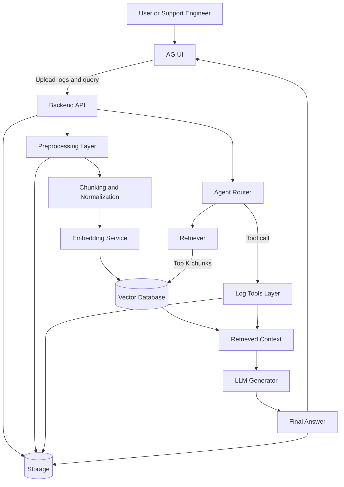

# 🚀 Log Analysis AI Agent  

An intelligent, end-to-end **AI-powered log analysis system** designed to streamline debugging, accelerate incident response, and extract actionable insights from complex logs.

---

## 👨‍💻 Genz Developers  
- **Jay Paun**  
- **Preet Patel**

---

## ✨ Key Features  

### 🔹 ErrorSplitter  
Automatically separates logs by error types for focused debugging.

### 🔹 LogSummary  
Generates concise, AI-driven summaries of long and noisy log files.

### 🔹 StackTrace Analyzer  
Simplifies and extracts stack traces for fast root-cause identification.

### 🔹 Error Line Detection (`error_lines`)  
Pinpoints critical failure lines in large logs.

### 🔹 Error Code Search (`error_code`)  
Searches and extracts error codes (HTTP status codes, custom error codes, etc.) from logs.

### 🔹 Log Level Filtering (`filter_log_level`)  
Filters logs by severity levels (ERROR, WARN, INFO, DEBUG, FATAL, etc.).

### 🔹 Keyword-Based Log Search (`search_on_keyword`)  
Searches and highlights logs using specific keywords or patterns.

### 🔹 Time Slicing  
Analyzes log activity within selected time ranges.

### 🔹 Root-Cause Extraction  
Applies AI/ML logic to identify probable causes behind errors.

### 🔹 Unified Utility Interface (`log_utility_main`)  
Centralized entry point providing menu-driven access to all log analysis utilities.

---

## 🏗️ System Architecture

The following diagram illustrates the end-to-end flow of the log analysis system:



---

## 📂 Dataset Sources  

We use publicly available datasets for training and benchmarking:

- 🔗 https://github.com/logpai/loghub  
- 🔗 https://www.kaggle.com/datasets/ayenuryrr/loghub-hdfs-hadoop-distributed-file-system-data
- 🔗 https://github.com/logpai/loghub

---

## 📂 Project Structure

```text
log-analysis-AI-agent/
├── 🤖 agent/
│   ├── agent_core.py        # Core agent orchestration
│   ├── reasoning.py         # Logic and reasoning modules
│   └── tools.py             # Utility tools for the agent
├── 💾 data/
│   ├── 📥 input/            # Directory for raw log files
│   └── 📤 output/           # Directory for analysis results
├── 🖥️ ui/
│   └── app.py               # Main application interface
├── ⚙️ utilities/
│   ├── error_code.py         # Search and extract error codes
│   ├── error_lines.py        # Extract specific error lines
│   ├── filter_log_level.py  # Filter logs by log level (INFO, ERROR, etc.)
│   ├── log_summary.py       # Generate comprehensive log summaries
│   ├── log_utility_main.py  # Main entry point - unified access to all utilities
│   ├── search_on_keyword.py # Keyword-based search
│   ├── stacktrace.py        # Stacktrace parsing and analysis
│   └── time_slice.py        # Filter logs by time windows
└── 📄 README.md             # Project documentation
```

## Safety Check

Before deploying or integrating, verify the pipeline is working correctly:

```bash
# Run full pipeline verification (3 scenarios)
python scripts/verify_pipeline.py

# Run smoke test
python -m unittest code_testing.test_pipeline_smoke
```

The verification script checks:
- **Scenario A**: Heuristic end-to-end execution
- **Scenario B**: LLM mode graceful failure handling
- **Scenario C**: Resume/idempotency (artifacts not rerun)

All scenarios must pass for a **GO** status.

## 🚀 Quick Start

### Using the Unified Utility Interface

The easiest way to access all log analysis utilities is through the main interface:

```bash
# Run the main utility interface
python utilities/log_utility_main.py

# Or import as a module
python -m utilities.log_utility_main
```

This provides a menu-driven interface to access:
- Search by Keyword
- Filter by Log Level
- Log Summary
- Extract Stacktraces
- Time Slice
- Search by Error Code
- Get Error Lines

### Using Individual Utilities

You can also import and use individual utilities programmatically:

```python
from utilities.log_utility_main import (
    search_keyword,
    filter_by_log_level,
    summarize_log,
    extract_stacktraces,
    slice_by_time,
    search_by_error_code
)

# Example: Search for keywords
result_file = search_keyword(log_content, "error")

# Example: Filter by log level
error_lines = filter_by_log_level(log_file, "ERROR")

# Example: Generate log summary
summary = summarize_log(log_file)
```

### Running Individual Utility Scripts

Each utility can also be run independently:

```bash
# Filter by log level
python utilities/filter_log_level.py

# Generate log summary
python utilities/log_summary.py

# Extract stacktraces
python utilities/stacktrace.py data/sample.log

# Search by error code
python utilities/error_code.py data/sample.log 503 404
```

---

## 🔮 Coming Soon  

- ReactJS-based Web UI  
- Automated pipeline for log ingestion  
- Real-time log monitoring system with alerts  
- LLM-enhanced advanced log reasoning  
- Visualization dashboard for anomalies  

---

## ⭐ Vision  

Logs are messy.  
Debugging is slow.  
Our goal: Make log analysis **smarter, faster, and fully automated** using AI.

