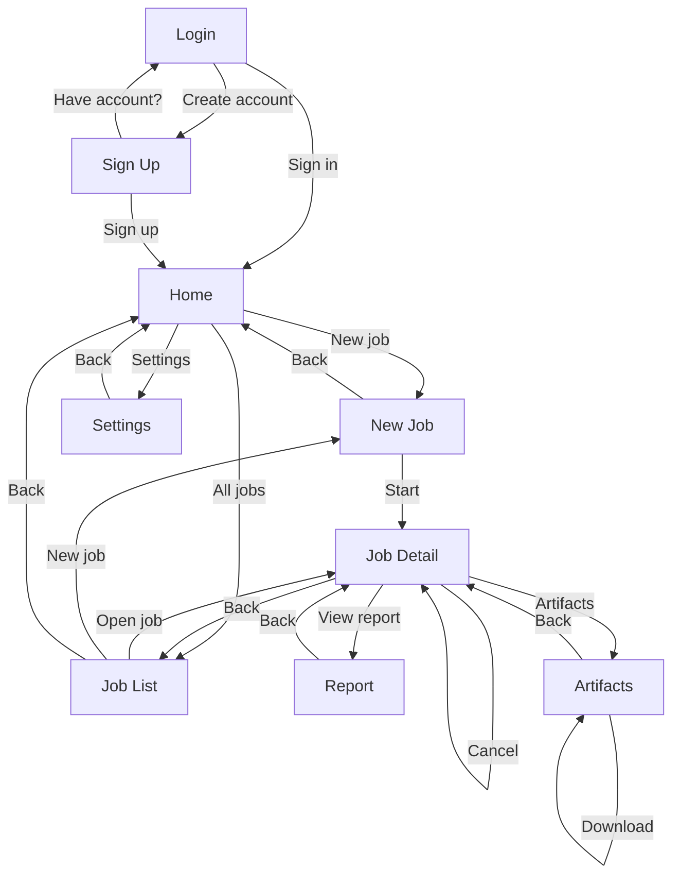

# Desktop App UI Workflow – Screen-to-Screen for Designers

This doc gives a UI designer a clear map of **which screen goes to which** and what each screen is for. Use it for navigation, wireframes, and flow.

**Note:** If the app requires authentication, the flow starts at **Login** (or **Sign up**); after successful auth, user lands on **Home**. If the app works without auth, you can skip or hide Login/Sign up.

---

## 1. Screen Map (Overview)

```
                    ┌─────────────────┐
                    │  LOGIN / SIGN UP │
                    │   (Auth gate)    │
                    └────────┬────────┘
                             │
                             ▼
                    ┌─────────────────┐
                    │     HOME        │
                    │   (Dashboard)   │
                    └────────┬────────┘
                             │
              ┌──────────────┼──────────────┐
              │              │              │
              ▼              ▼              ▼
     ┌─────────────┐  ┌─────────────┐  ┌─────────────┐
     │  NEW JOB    │  │  JOB LIST   │  │  SETTINGS   │
     │  (Create)   │  │  (All Jobs) │  │  (optional) │
     └──────┬──────┘  └──────┬──────┘  └─────────────┘
            │                │
            │    ┌───────────┘
            │    │
            ▼    ▼
     ┌─────────────────┐
     │   JOB DETAIL     │
     │ (Status, Report) │
     └────────┬────────┘
              │
    ┌─────────┼─────────┐
    ▼         ▼         ▼
┌────────┐ ┌────────┐ ┌────────────┐
│ REPORT │ │ARTIFACTS│ │ DOWNLOAD   │
│ VIEW   │ │ LIST    │ │ (file)     │
└────────┘ └────────┘ └────────────┘
```

---

## 2. Screen-by-Screen: Name, Purpose, Where It Goes

### **Screen 0a: Login**

| Item | Description |
|------|-------------|
| **Purpose** | User signs in to access the app (first screen if auth is required). |
| **User sees** | Email/username and password fields, “Sign in” / “Log in” button, “Forgot password?” link (optional), “Create account” / “Sign up” link. |
| **From here user can go to** | **Home** (after successful login), **Sign up** (tap “Create account” / “Sign up”), **Forgot password** (optional screen). |

---

### **Screen 0b: Sign up (Create account)**

| Item | Description |
|------|-------------|
| **Purpose** | New user creates an account. |
| **User sees** | Fields (e.g. email, username, password, confirm password), “Create account” / “Sign up” button, “Already have an account? Sign in” link. |
| **From here user can go to** | **Home** (after successful sign up), **Login** (tap “Already have an account? Sign in”). |

---

### **Screen 1: Home (Dashboard)**

| Item | Description |
|------|-------------|
| **Purpose** | First screen after launch. Quick overview and entry to main actions. |
| **User sees** | Summary (e.g. recent jobs count, status breakdown), “New analysis” action, link to full job list. Optional: quick question input. |
| **From here user can go to** | **New Job** (tap “New analysis” / “Create job”), **Job List** (tap “View all jobs” / “Jobs”), **Settings** (if you have a settings entry point). |

---

### **Screen 2: New Job (Create job)**

| Item | Description |
|------|-------------|
| **Purpose** | User enters the question and log source, then starts an analysis. |
| **User sees** | Question input (required), log file picker or path (optional), mode selector (RAG / Heuristic), optional model selector, “Start analysis” (submit) button, “Cancel” or “Back”. |
| **From here user can go to** | **Job Detail** (after submit – open the new job), **Home** or **Job List** (Back/Cancel). |

**Design note:** After “Start analysis”, either auto-navigate to Job Detail for the new job, or show a toast/snackbar with “Job started” and a link “View job”.

---

### **Screen 3: Job List (All jobs)**

| Item | Description |
|------|-------------|
| **Purpose** | List all analysis jobs so user can open one. |
| **User sees** | List of jobs (e.g. question snippet, status, date). Optional: filters (All / Running / Succeeded / Failed), search, sort. |
| **From here user can go to** | **Job Detail** (tap a row), **Home** (Back or logo), **New Job** (e.g. “New analysis” in header). |

---

### **Screen 4: Job Detail**

| Item | Description |
|------|-------------|
| **Purpose** | Single job: status, progress, report, and actions (view report, artifacts, cancel). |
| **User sees** | Job id/question, status (Queued / Running / Succeeded / Failed / Cancelled), progress (e.g. step name + %), current step label. When done: report preview or link, list of artifacts. Actions: “View full report”, “Artifacts”, “Cancel job” (if running/queued), “Back” / “Jobs”. |
| **From here user can go to** | **Report View** (view full report), **Artifacts List** (list of files), **Download** (open/download a single file), **Job List** (Back), **Home**. |

**Design note:** Report and Artifacts can be tabs/panels on the same screen or separate screens; the workflow is “from Job Detail → Report” and “from Job Detail → Artifacts”.

---

### **Screen 5: Report View**

| Item | Description |
|------|-------------|
| **Purpose** | Show the full analysis report (e.g. markdown or rendered text). |
| **User sees** | Full report content, optional “Copy” / “Download”. |
| **From here user can go to** | **Job Detail** (Back / “Back to job”). |

---

### **Screen 6: Artifacts List**

| Item | Description |
|------|-------------|
| **Purpose** | List all artifacts for this job (e.g. retrieval.json, findings.json, final_answer.md) with download. |
| **User sees** | List of artifact names, optional type/size, “Download” or “Open” per row. |
| **From here user can go to** | **Job Detail** (Back), **Download** (open or save a file – can be same window or system dialog). |

---

### **Screen 7: Settings (optional)**

| Item | Description |
|------|-------------|
| **Purpose** | API URL, default model, theme, etc. |
| **User sees** | Form fields and toggles. |
| **From here user can go to** | **Home** or previous screen (Back / Save). |

---

## 3. Navigation Flow (Mermaid) – Which Screen Goes to Which

Use short labels so the diagram renders clearly. Copy the block below into any Mermaid-supported viewer (e.g. GitHub, Mermaid Live Editor).



---

## 4. Quick Reference Table – From → To

| From screen | User action | Goes to screen |
|-------------|-------------|----------------|
| Login | “Sign in” (success) | Home |
| Login | “Create account” / “Sign up” | Sign up |
| Sign up | “Create account” (success) | Home |
| Sign up | “Already have an account? Sign in” | Login |
| Home | “New analysis” / “Create job” | New Job |
| Home | “View all jobs” / “Jobs” | Job List |
| Home | “Settings” | Settings |
| New Job | “Start analysis” (submit) | Job Detail (new job) |
| New Job | “Back” / “Cancel” | Home or Job List |
| Job List | Tap a job row | Job Detail |
| Job List | “New analysis” | New Job |
| Job List | “Back” | Home |
| Job Detail | “View report” / “Report” | Report View |
| Job Detail | “Artifacts” | Artifacts List |
| Job Detail | “Cancel job” | (stay on Job Detail; status updates) |
| Job Detail | “Back” | Job List |
| Report View | “Back” | Job Detail |
| Artifacts List | “Back” | Job Detail |
| Artifacts List | “Download” (per file) | Download / open file (same or system) |
| Settings | “Back” / “Save” | Home |

---

## 5. Suggested Desktop Layout Hints

- **Login / Sign up:** Centered card or panel; one primary button (“Sign in” / “Create account”); link to the other auth screen at bottom. Optional: “Remember me”, “Forgot password”.
- **Home:** Single main content area; primary CTA = “New analysis”; secondary = “View all jobs”.
- **New Job:** Single form; one primary button “Start analysis”; secondary “Cancel” or “Back”.
- **Job List:** Table or card list; each row opens Job Detail; header action “New job”.
- **Job Detail:** Header (question + status) → Progress (if running) → Tabs or sections: “Report” | “Artifacts” → Actions: “Cancel” (when applicable), “Back”.
- **Report / Artifacts:** Can be right panel or second column from Job Detail to avoid extra “screen” feel; Back returns focus to Job Detail.

Use this to decide **which screen goes to which** and to hand off to a UI designer for wireframes and visual design.
