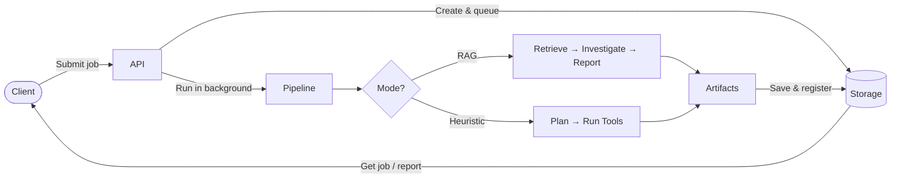
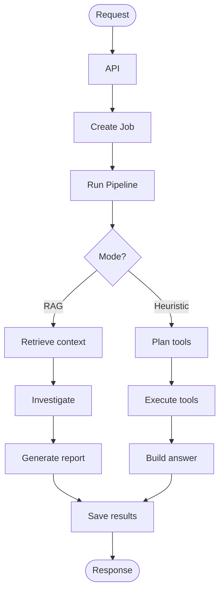

# Log Analysis AI Agent – Pipeline Flow (High Level)

## Pipeline Overview

## End-to-End Flow

## What Each Stage Does

| Stage | Purpose |
|-------|--------|
| **API** | Accepts question + log path, creates job, returns job ID, runs pipeline in background. |
| **Create Job** | Persists job (queued), assigns ID, stores in runs. |
| **Run Pipeline** | Validates input, picks mode (RAG vs Heuristic), runs the chosen path. |
| **RAG path** | Retrieve (vector search on logs) → Investigate (LLM analysis) → Generate report. |
| **Heuristic path** | Plan (keyword-based tool selection) → Execute tools → Build answer. |
| **Save results** | Writes artifacts, updates job status (succeeded/failed/cancelled), registers artifact paths. |
| **Response** | Client polls or fetches job; gets status, report, and artifact metadata. |

## One-Line Summary

**Request → API creates job → Pipeline runs (RAG: retrieve → investigate → report, or Heuristic: plan → run tools) → Results saved → Client gets job/report.**
