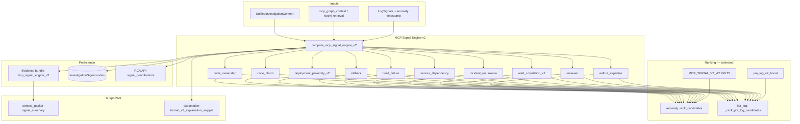

# Deterministic MCP Signal Engine v2

Additive RCA signals computed from `UnifiedInvestigationContext` and investigation graph
retrieval. Deterministic ranking remains authoritative; v2 signals extend (not replace)
existing graph, keyword, and MCP context signals.

## Signal pipeline

## Signals

| Signal | Source | Value range |
|--------|--------|-------------|
| `code_ownership` | Commit/PR author concentration on path | 0–1 |
| `code_churn` | Commits touching path in 7/30/90d windows | 0–1 |
| `deployment_proximity_v2` | Nearest deployment for path commits vs anchor time | 0–1 |
| `rollback` | Rollback/failed deployment on path commits | 0–1 |
| `build_failure` | Failed Jenkins/CI builds for path commits | 0–1 |
| `service_dependency` | Upstream/downstream alert/incident/trace failures | 0–1 |
| `incident_recurrence` | Prior investigations matching path/service/keywords | 0–1 |
| `alert_correlation_v2` | Datadog alerts, metrics, traces aligned to path/service | 0–1 |
| `reviewer` | PR reviewers on path-touching PRs | 0–1 |
| `author_expertise` | Dominant author expertise on path commits | 0–1 |

Each signal returns `{ value, weight, contribution, evidence }`.

## Configuration

| Variable | Default | Purpose |
|----------|---------|---------|
| `MCP_SIGNAL_V2_ENABLED` | `true` | Master toggle |
| `MCP_CHURN_WINDOWS_DAYS` | `7,30,90` | Churn lookback windows |
| `MCP_CHURN_HIGH_WATERMARK` | `8` | Commits per window for max churn score |
| `MCP_V2_WEIGHT_<SIGNAL>` | see `mcp_signal_v2_config.py` | Per-signal ranking weight |

## Integration points

- **Anomaly RCA:** `signal_computation.compute_signals()` merges v2 values into per-file scores.
- **Jira/log RCA:** `_rank_jira_log_candidates()` adds `jira_log_v2_boost`.
- **Evidence:** `contributions_to_bundle_fields()` → `mcp_signal_engine_v2` block.
- **Neo4j:** `graph/investigation_signal_persistence.py` → `(Investigation)-[:HAS_RCA_SIGNAL]->(InvestigationSignal)`.
- **API:** `JiraRcaExplanationPayload.signal_contributions` and `evidence_summary.signal_contributions`.
